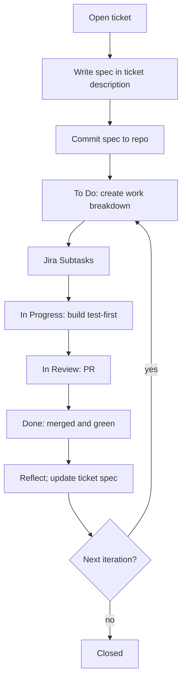

<!--
SPDX-FileCopyrightText: Copyright © 2026 Caleb Cushing

SPDX-License-Identifier: CC-BY-NC-SA-4.0
-->

# Jira Iteration Loop

XTC carries the work. `~/WHERE-WAS-I.md` is recall, not the tracker.

## Rules

- In `Open`, refine the description. Do not add Subtasks.
- Put the spec in the ticket and in the repo. A spec goes at the highest
  visible level it applies to.
- In `To Do`, create the work breakdown. Each item becomes a Subtask on the
  ticket.
- Start a Subtask, then move the ticket to `In Progress`. Build test-first.
- Open the PR, then move the ticket to `In Review`.
- Move to `Done` after merge and green checks.
- Reflect. Update the ticket spec. Decide on another iteration.

Use cases stay deferred. Most tickets need none.
