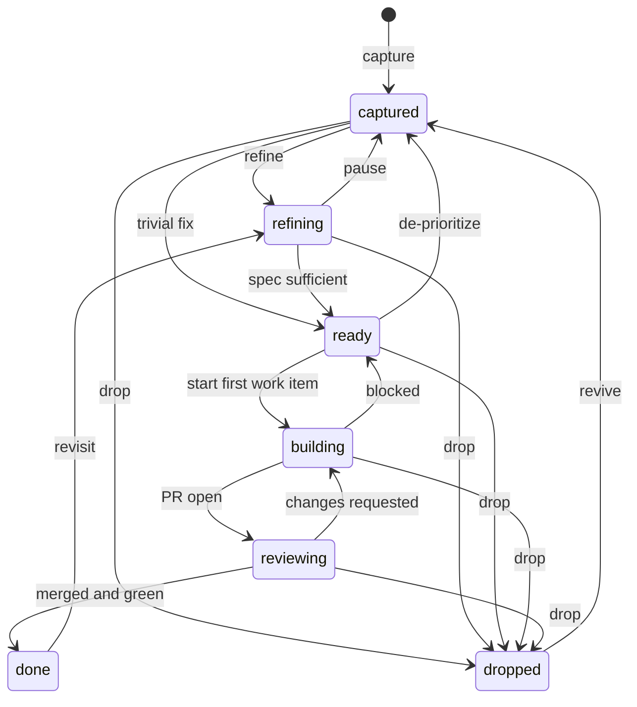

<!--
SPDX-FileCopyrightText: Copyright © 2026 Caleb Cushing

SPDX-License-Identifier: CC-BY-NC-SA-4.0
-->

# Jira Workflow

Read `.config/agent/project.yaml` before Jira work. If missing, stop and name the path. Missing config stops all Jira work.

The config binds this rule set to one repo. Read issue state live. Do not cache
keys or statuses. Use `tracker.site` to resolve the Atlassian site.

## Required Companion Skills

- **`hemingway`** — issue descriptions and comments are prose

## Issue content

Read `references/issue-content.md` before writing a description or comment.

## Workflow roles

The diagram uses logical roles. The config supplies the Jira status names in
`tracker.statuses`.

| Role        | Config key                   | Meaning                                        |
| ----------- | ---------------------------- | ---------------------------------------------- |
| `captured`  | `tracker.statuses.captured`  | Captured. Not refined. Starting state.         |
| `refining`  | `tracker.statuses.refining`  | Refinement. Ticket description holds the spec. |
| `ready`     | `tracker.statuses.ready`     | Spec sufficient. Break down into work items.   |
| `building`  | `tracker.statuses.building`  | Agent works the breakdown.                     |
| `reviewing` | `tracker.statuses.reviewing` | PR open. Checks or review pending.             |
| `done`      | `tracker.statuses.done`      | Merged. Checks green.                          |
| `dropped`   | `tracker.statuses.dropped`   | Dropped.                                       |

Jira allows any status to move to any status. Keep it flexible. These edges are
intent, not enforcement. Edges out of `captured` and `refining` are unverified:
no issue sat in either state when transitions were checked.

## Read issues

Run JQL `project = <tracker.project> ORDER BY key ASC` for live state. Board
reads stay project-wide. Add
`AND labels = "<tracker.labels.project_prefix><repo>"` only when the user scopes a
read to one repo; old issues without that label still appear in project-wide
reads. Page with `nextPageToken` until `isLast`. Read one known
issue by key. Use `getJiraBoardConfig` with `tracker.board` for columns and
board/backlog datasets for parking.

Do not treat a status as a progress bucket.

## Create issues

Create issues in `tracker.project`. Use the work types in `tracker.work_types`.
Do not invent types that are not configured.

Put the spec in the description. A spec goes at the highest visible level it
applies to. A UX spec lives at the UX level even when it reaches down into
code.

New work starts in `captured` and gets the
`<tracker.labels.project_prefix><repo>` label. Labels are a full list, not
appended.

## Update issues

Set fields explicitly. Labels are a full list, not appended. Rich text is
markdown unless the body holds media, panels, or other nodes markdown cannot
represent.

Comments are separate calls. A comment passed inside a transition may be
dropped without error.

## Move issues

Call `listJiraIssueTransitions`. Use a configured ID from `tracker.transitions`
only when that ID appears in the result and its `to.name` matches the target
status in `tracker.statuses`. If the ID is absent or stale, match the live
transition's `to.name` to the target role's value in `tracker.statuses` and use
the returned ID. Never move on an unchecked ID. Transition names differ from status names.

Rules:

- Do not add work breakdown in `refining`. Refine the description there.
- Create the breakdown in `ready`. Each item becomes a work item on the ticket.
- Move to `building` when the first work item starts.
- Move to `reviewing` when the PR opens.
- Move to `done` after merge and green checks.
- Run `completion-retrospective` after that move. Do not end the turn until
  it finishes.
- Move to `dropped` when dropped. Reopen from `done` or `dropped` into
  `refining` or `captured` as the work requires.

## Integration

- `iterative-development` — iteration loop and work breakdown
- `use-case-creator` — spec placement and use case format
