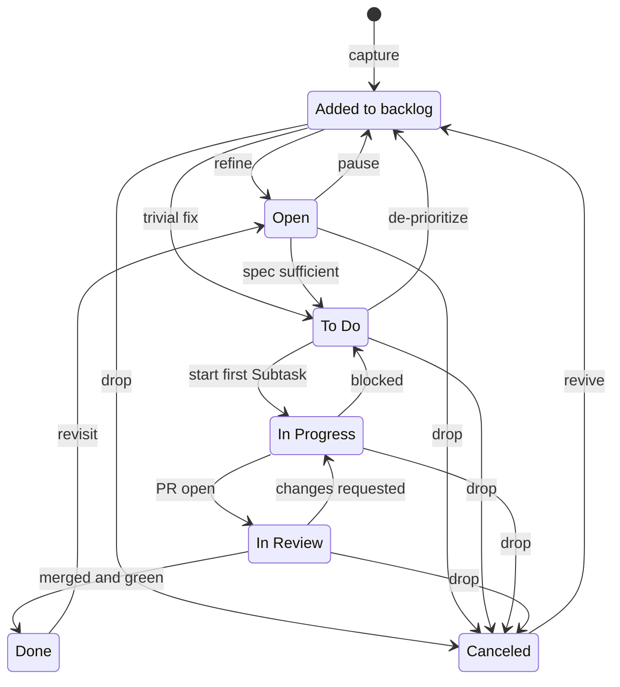

<!--
SPDX-FileCopyrightText: Copyright © 2026 Caleb Cushing

SPDX-License-Identifier: CC-BY-NC-SA-4.0
-->

# Jira Workflow

XTC is the execution tracker for `agent-skills`. `~/WHERE-WAS-I.md` is recall.
Read issue state live. Do not cache keys or statuses.

Site: `https://xenoterracide.atlassian.net`. Cloud ID
`fc5ce4e3-4638-4a37-9aaf-1a2591482c2e`. Project `XTC`. Board 3, KAN board.

## Required Companion Skills

- **`hemingway`** — issue descriptions and comments are prose

## Status model

| Status             | Meaning                                                    |
| ------------------ | ---------------------------------------------------------- |
| `Added to backlog` | Captured. Not refined. Starting state.                     |
| `Open`             | Refinement. Ticket description holds the spec.             |
| `To Do`            | Spec sufficient. Agent creates work breakdown as Subtasks. |
| `In Progress`      | Agent works the Subtasks.                                  |
| `In Review`        | PR open. Checks or review pending.                         |
| `Done`             | Merged. Checks green.                                      |
| `Canceled`         | Dropped.                                                   |

## Intended state flow

Jira currently allows any status to move to any status. Keep Jira flexible.
Edges out of `Added to backlog` and `Open` are intent. No issue sat in either
state when transitions were checked. Those edges are not verified against
Jira.

## Read issues

Run JQL `project = XTC ORDER BY key ASC` for live state. Read one known issue
by key. Use board and backlog datasets for columns and parking.

Do not treat a status as a bucket. Drop `now`, `next`, and `squirrel` labels.

## Create issues

Create the issue in `XTC`. Use the work types `Epic`, `Feature`, `Task`,
`Bug`, and `Subtask`. Do not invent `Spec`, `Ready`, `Plan`, `Decision`, or
`Repo` types.

Put the spec in the description. A spec goes at the highest visible level it
applies to. A UX spec lives at the UX level even when it reaches down into
code.

New work starts in `Added to backlog`.

## Update issues

Set fields explicitly. Labels are a full list, not appended. Rich text is
markdown unless the body holds media, panels, or other nodes markdown cannot
represent.

Comments are separate calls. A comment passed inside a transition may be
dropped without error.

## Move issues

Take the transition ID from `listJiraIssueTransitions`. Transition name is
the transition's own name, not the target status. `starting` and `In Progress`
both reach `In Progress` today.

Rules:

- Do not add Subtasks in `Open`. Refine the description there.
- Create the work breakdown in `To Do`. Each item becomes a Subtask on the
  ticket.
- Move to `In Progress` when the first Subtask starts.
- Move to `In Review` when the PR opens.
- Move to `Done` after merge and green checks.
- Move to `Canceled` when dropped. Reopen from `Done` or `Canceled` into
  `Open` or `Added to backlog` as the work requires.

## Integration

- `iterative-development` — iteration loop and work breakdown
- `use-case-creator` — spec placement and use case format
